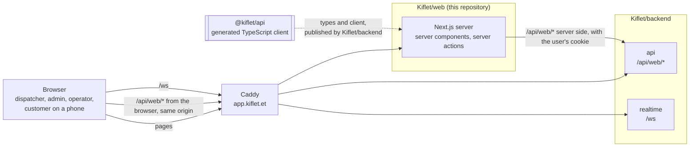
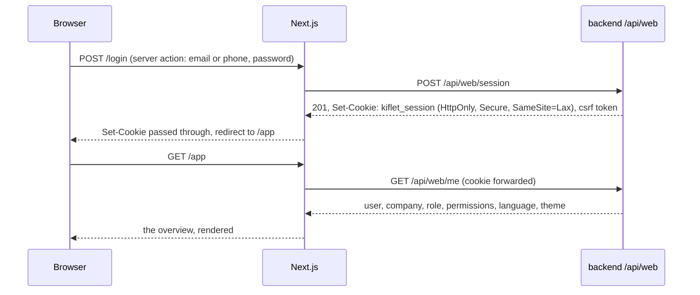

# Kiflet web: architecture

The Next.js app that serves everything Kiflet shows in a browser: the
public pages (landing, sign-in and sign-up, shipment tracking, delivery
confirmation), the company dashboard (`/app`) and the operator's pages
(`/platform`).

It holds no business rules and no database. Everything it shows and
changes goes through the Go backend's web API. The whole system,
including the backend's modules, RabbitMQ, Redis and deployment, is in
[Kiflet/backend `docs/architecture.md`](https://github.com/Kiflet/backend/blob/main/docs/architecture.md).
This document covers this repository's part. `docs/migration.md` is the
plan for building it from the pages the Go app renders today.

Contents:

1. [Where it sits](#1-where-it-sits)
2. [Stack](#2-stack)
3. [Routes](#3-routes)
4. [Rendering and data](#4-rendering-and-data)
5. [Signing in and sessions](#5-signing-in-and-sessions)
6. [The API client](#6-the-api-client)
7. [Live updates](#7-live-updates)
8. [Maps](#8-maps)
9. [Languages](#9-languages)
10. [The design system](#10-the-design-system)
11. [Security](#11-security)
12. [Performance](#12-performance)
13. [Testing](#13-testing)
14. [Build and deployment](#14-build-and-deployment)
15. [Repository layout](#15-repository-layout)

---

## 1. Where it sits



- **One origin.** Caddy serves this app at `app.kiflet.et` and sends
  `/api/*` and `/ws` on the same host to the backend. The browser never
  calls another origin, so there is no CORS, and the session cookie the
  backend sets works for both.
- **The contract** is `api/openapi/web.yaml` in Kiflet/backend, published
  as the `@kiflet/api` package. This app depends on a version of it; a
  change in the API that breaks this app shows up as a type error when the
  package is updated.

---

## 2. Stack

| Concern | Choice | Why |
|---|---|---|
| Framework | Next.js (App Router), React Server Components | server rendering for small public pages and fast dashboards; server actions for forms |
| Language | TypeScript, `strict` | the API's types come generated |
| Package manager | pnpm | |
| Styling | Tailwind CSS with the Desk and Night tokens (section 10) | the design is token-based already |
| Components | shadcn/ui (new-york style), Radix primitives | the Desk design is shadcn/ui's new-york style on Kiflet's palette |
| Icons | lucide-react | the icons the design and today's pages use |
| Fonts | Geist and Geist Mono, self-hosted (`next/font/local`) | as today; no request to a font CDN |
| Data in client components | TanStack Query | caching, refetch on live messages |
| Forms | React Hook Form with Zod, submitted through server actions | field errors from the API mapped onto fields |
| Tables | TanStack Table | sorting, column choice, bulk selection on the shipment list |
| Maps | MapLibre GL JS | vector-capable, themeable; same OpenStreetMap tiles as today |
| Languages | next-intl | English and Amharic |
| Dates | `Intl.DateTimeFormat` with the company's time zone (Africa/Addis_Ababa) | no date library needed |
| Tests | Vitest and Testing Library; Playwright | section 13 |
| Errors and traces | OpenTelemetry (`@vercel/otel`) to the backend's collector; Sentry optional | one trace from the browser's request through the backend |

---

## 3. Routes

Route groups keep the three audiences apart, each with its own layout.

```
app/
  (public)/                     layout: public header and footer, no session needed
    page.tsx                    landing
    login/  signup/  signup/verify/  forgot/  reset/[token]/  reset/phone/  verify-email/[token]/
    track/  track/[number]/  track/phone/  track/mine/
    c/[token]/                  delivery confirmation
  (dashboard)/app/              layout: the shell (sidebar, top bar), needs a staff session
    page.tsx                    overview
    shipments/  shipments/new/  shipments/import/  shipments/[id]/  shipments/[id]/edit/  shipments/[id]/waybill/
    drivers/  drivers/new/  drivers/[id]/  drivers/[id]/edit/  drivers/message/
    vehicles/  vehicles/new/  vehicles/[id]/  vehicles/[id]/edit/
    alerts/  alerts/recipients/
    reports/
    team/  team/new/  team/[id]/edit/
    settings/  settings/api/  settings/webhooks/  settings/webhooks/[id]/  settings/sms/
    billing/  billing/invoices/[id]/  billing/payments/[id]/
    help/  help/new/  help/[id]/
    account/  account/password/
    audit/
  (operator)/platform/          layout: the shell, needs the operator role
    page.tsx  billing/  invoices/[id]/  support/  support/[id]/  audit/  health/  tenants/[id]/
  (dev)/dev/                    built only with NEXT_PUBLIC_DEV_PAYMENTS=true
    payments/[reference]/  cbebirr/
middleware.ts                   CSP nonce, redirect to /login without a session cookie
```

The paths are the ones the Go app serves today, so links already sent by
SMS and email (`/track/{number}`, `/c/{token}`, `/reset/{token}`) keep
working when Caddy moves them here.

---

## 4. Rendering and data

- **Server components by default.** A page fetches what it shows on the
  server, with the user's session cookie forwarded to the API, and renders
  HTML. No loading spinner for the first view.
- **Client components only where needed:** the map, the live socket,
  filters that change the URL, tables with selection, the signature view,
  menus and dialogs.
- **Forms are server actions.** The action calls the API; on a validation
  error it returns the API's field errors to the form; on success it
  revalidates the affected paths and redirects, as the Go app's
  post-redirect-get does today.
- **What the user may do comes from the API.** Each resource carries
  `actions` (for example `["assign", "cancel"]`) and the page shows only
  those buttons. This app never decides a role's rights or a shipment's
  next status itself.
- **Caching:** dashboard data is per user and live, so server fetches use
  `cache: "no-store"`. Public tracking pages may be cached by Caddy for a
  few seconds per tracking number.
- **Errors:** an API `401` sends the user to `/login?next=…`; `403` and
  `404` render the not-found page (a company never learns another's IDs
  exist); `5xx` renders the error page with the request ID to quote.

---

## 5. Signing in and sessions



- The backend owns sessions (Postgres, cached in Redis). This app stores
  nothing about the user beyond what each request asks the API.
- **CSRF:** the API checks a token sent in the `X-CSRF-Token` header on
  every change. Server actions add it from the cookie; client-side calls
  do the same through the API client.
- `middleware.ts` only checks that a session cookie is present before
  rendering a dashboard route, for a quick redirect; the API decides
  whether it is valid.
- Signing out calls `DELETE /api/web/session` and clears the cookie.

---

## 6. The API client

- `@kiflet/api` provides the types (`openapi-typescript`) and a client
  (`openapi-fetch`). `lib/api/server.ts` makes a client for server
  components and actions (base URL `API_INTERNAL_URL`, the cookie and
  CSRF headers from the request); `lib/api/browser.ts` one for client
  components (same origin, `credentials: "same-origin"`).
- Errors have one shape, `{ error: { code, message, fields } }`, turned
  into a typed `ApiError` by both clients.
- No hand-written types for API data. A missing field is a change in
  Kiflet/backend first, then a new package version here.

---

## 7. Live updates

Today's dashboard refetches marked parts of a page when a WebSocket
message says something changed (`data-live-region`, `static/app.js`).
This app does the same with React:

- `LiveProvider` (client component, in the dashboard layout) opens
  `wss://app.kiflet.et/ws`, reconnects with backoff, and shows the "Live"
  dot in the shell.
- Messages name what changed: `{ "type": "shipment", "id": "…" }`,
  `{ "type": "alerts" }`, `{ "type": "position", "driver_id", "lat",
  "lng", "at", … }`.
- Components subscribe by type. A shipment message invalidates the
  matching TanStack Query keys (or calls `router.refresh()` on server-
  rendered pages); position messages move markers on the map without a
  fetch.
- Live updates are best effort: a page that missed messages catches up on
  its next fetch, and refetches when the tab becomes visible again.

---

## 8. Maps

One `Map` client component on MapLibre GL, used by:

| Map | Where | Draws |
|---|---|---|
| Fleet | overview | drivers at their last position (online, quiet, offline), destinations of active loads, a straight line from pickup; picking a load fetches `GET /api/web/shipments/{id}/trail` and draws the road taken, gaps dashed |
| Shipment | a shipment's page | pickup, destination with its tolerance circle, the trail with gaps dashed and their length, the truck, the delivery point |
| Driver | a driver's page | last position, moved live |
| Tracking | public tracking page | rough position only (privacy, as today), destination; no trail |
| Pin picker | booking form | a dropped pin for an address the town list doesn't know |

Colours come from the theme tokens (routes and the truck in `info`,
drop-off in `bad`, delivery in `good`, start in `muted`); in Night the
raster tiles are darkened with the same filter as today
(`invert(1) hue-rotate(180deg) brightness(0.95) contrast(0.85)`). The
tile URL and credit come from the API's config, as the Go app's do.

---

## 9. Languages

- next-intl with `messages/en.json` and `messages/am.json`. A test checks
  that both files have the same keys, as `internal/text`'s test does in the
  backend today.
- **Public pages** (tracking, confirmation, sign-in for drivers and
  customers) are in both languages from the first release, as now. Their
  words come from the backend's `internal/text/en.go` and `am.go`
  (`track.*`, `confirm.*` and so on), copied into the message files with
  the same keys.
- **The dashboard** is English until a native speaker has reviewed the
  Amharic (the backend's ROADMAP, item W1). The language switch in
  settings waits for it.
- The SMS and email texts stay in the backend; this app only previews them
  through the API (the SMS preview in Settings).

---

## 10. The design system

The look is the "Desk" design (light) and "Night" (dark), made on the Claude
Design canvas and built in the Go app's `internal/web/static/app.css`. Its
tokens become CSS variables in `app/globals.css` and Tailwind theme colours
with the same names, so the two apps can be compared side by side during the
migration.

### Base tokens

| Token | Desk (light) | Night (dark) |
|---|---|---|
| `--bg` | `#f5f4f0` | `#131312` |
| `--surface` | `#ffffff` | `#1c1c1b` |
| `--surface-2` | `#eeede8` | `#262625` |
| `--surface-3` | `#e4e2db` | `#30302e` |
| `--border` | `#e2e0d9` | `#2c2c2a` |
| `--border-strong` | `#d6d3cb` | `#3a3a37` |
| `--text` | `#1c1b18` | `#ededeb` |
| `--text-2` | `#45423b` | `#c9c8c3` |
| `--muted` | `#5f5b53` | `#a3a29c` |
| `--accent` | `#1c1b18` | `#ededeb` |
| `--accent-hover` | `#33312c` | `#ffffff` |
| `--on-accent` | `#fafaf8` | `#131312` |
| `--good` | `#17663a` | `#81c995` |
| `--warn` | `#b54708` | `#f4b46a` |
| `--bad` | `#b42318` | `#f28b82` |
| `--info` | `#1e40af` | `#8ab4f8` |
| `--focus` | `#8a867d` | `#8a8984` |
| `--sidebar` | `#1c1b18` | `#171716` |
| `--sidebar-text` | `#d9d6ce` | `#c9c8c3` |
| `--sidebar-mark` / `--sidebar-mark-text` | `#f3f2ee` / `#1c1b18` | `#ededeb` / `#131312` |

Copy them from the backend's `static/app.css` at the commit the migration
starts from rather than from this table, in case they changed since.

### Derived tokens (both themes)

- Soft tints: `--good-soft`, `--warn-soft`, `--bad-soft`, `--info-soft` are
  10% of the colour over `--surface` (`color-mix`).
- `--ring`: 50% of `--focus`.
- Status badges, background and text: pending (transparent, muted),
  assigned (surface-2, text), in transit (info-soft, info), delayed
  (warn-soft, warn), arrived and delivered (good-soft, good), issue
  (bad-soft, bad), cancelled (surface-2, muted, struck through).
- Radius 12px (cards), 6px (controls); shadows `--shadow-xs`, `--shadow`,
  `--shadow-pop`.

Night's every text colour is at least 4.5:1 on every surface (WCAG AA). A
test in this repository checks the pairs with the same formula.

### Type and icons

Geist (100–900, variable) and Geist Mono for tracking numbers, plates and
codes; Noto Sans Ethiopic for Amharic; 14px base in the dashboard, 15px on
public pages. lucide icons, the same names as the Go app's
`internal/web/icons.go`.

### Components to build first

The shell (sidebar with company and user, top bar with breadcrumbs, search
and the alert bell), cards, KPI tiles (rows of 4, 5 and 6 that wrap at 1100
and 640px), badges with status colours, buttons (primary, ghost, danger,
small), inputs, selects, segmented controls, switches, tables with sorting
and selection, tabs with counts, toasts, empty states, dialogs, the
progress bar, the timeline (activity), and the map.

---

## 11. Security

- **CSP** with a nonce per request, set in `middleware.ts`:
  `script-src 'self' 'nonce-…' 'strict-dynamic'`, no `unsafe-inline` for
  scripts, `connect-src 'self'` plus the tile server, `img-src 'self'
  data: blob:` plus the tiles, `frame-ancestors 'none'`. As strict as the
  Go app's `script-src 'self'`.
- Other headers as today: HSTS, `X-Content-Type-Options`,
  `Referrer-Policy: strict-origin-when-cross-origin`, a narrow
  `Permissions-Policy`.
- No secrets in client bundles: only `NEXT_PUBLIC_*` reach the browser,
  and none of them is a secret.
- Nothing from the API is rendered as HTML (`dangerouslySetInnerHTML` is
  banned by lint), except the SMS preview, which the API returns as text.
- Uploads (shipment documents, CSV imports) go to presigned URLs from the
  API or through the API; this app never stores files.

---

## 12. Performance

| Page | Budget on a mid-range phone over 3G |
|---|---|
| Public tracking and confirmation | under 100 KB of JavaScript, largest content shown within 2.5 s |
| Sign-in | under 100 KB of JavaScript |
| Dashboard pages | under 250 KB of JavaScript on first load, the map loaded only where shown |

Checked in CI with Lighthouse CI on the public pages and bundle-size limits
on the rest.

---

## 13. Testing

| Kind | Tool | What |
|---|---|---|
| Unit | Vitest, Testing Library | components, formatting, the API error mapping, the token contrast test, the en/am key test |
| End to end | Playwright | the web sections of Kiflet/backend's `docs/E2E_TEST_GUIDE.md`: sign-up, booking, assigning, the overview, a shipment's page, alerts, settings, billing, the operator; public tracking and confirmation on a phone viewport; both themes |
| Accessibility | axe in Playwright | no serious violations on any page |
| Visual | Playwright screenshots | the shell, a shipment's page and the overview in both themes |

Playwright runs against the backend started from Kiflet/backend's compose
files at a pinned image tag, with the demo data (`seed`).

---

## 14. Build and deployment

- `next build` with `output: "standalone"`, in a small Node image
  (`ghcr.io/kiflet/web`), built by CI on every push to `main` and tagged
  with the commit.
- Settings: `API_INTERNAL_URL` (the backend's address on the private
  network), `PUBLIC_URL`, `NEXT_PUBLIC_DEV_PAYMENTS`, the OpenTelemetry
  endpoint. No secrets.
- Deployed by Kiflet/backend's `deployments/` compose files, two or more
  replicas behind Caddy, with a health check (`/api/health` in this app,
  which returns 200 when the server is up).
- Static assets are served with long cache lifetimes (their names carry a
  hash); pages with `no-store` where they show per-user data.

---

## 15. Repository layout

```
app/                    routes (section 3)
components/
  ui/                   shadcn/ui components, restyled to Desk and Night
  shell/                sidebar, top bar, breadcrumbs, search, bell
  map/                  the MapLibre map and its layers
  live/                 LiveProvider and hooks
  shipments/ drivers/ vehicles/ alerts/ …   feature components
lib/
  api/                  server and browser clients over @kiflet/api, ApiError
  i18n/                 next-intl setup
  format/               dates, distances, money (ETB), phone numbers
messages/               en.json, am.json
styles/ or app/globals.css   the tokens
public/                 fonts, icons, images
tests/                  Playwright
docs/                   this file, migration.md
```
