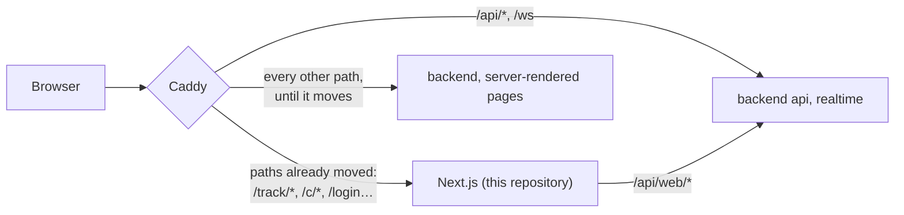

# Kiflet web: migration

How this repository takes over the pages the Go app renders today
(`internal/web/templates` in Kiflet/backend), one page at a time, without
a day when the product is down or half-built.

It is the web part of the whole plan,
[Kiflet/backend `docs/migration.md`](https://github.com/Kiflet/backend/blob/main/docs/migration.md),
where it is phase 4. `docs/architecture.md` describes what is being built.

Contents:

1. [How the switch works](#1-how-the-switch-works)
2. [What this repository needs from the backend first](#2-what-this-repository-needs-from-the-backend-first)
3. [Step 1: the empty app](#step-1-the-empty-app)
4. [Step 2: the design system](#step-2-the-design-system)
5. [Step 3: the shell and sessions](#step-3-the-shell-and-sessions)
6. [Step 4: pages, in waves](#step-4-pages-in-waves)
7. [The page inventory](#the-page-inventory)
8. [Parity: when a page is done](#parity-when-a-page-is-done)
9. [Words: moving the text](#words-moving-the-text)
10. [Rolling back](#rolling-back)
11. [Risks](#risks)
12. [Done](#done)

---

## 1. How the switch works

Caddy (in Kiflet/backend's `deployments/`) decides, path by path, which app
answers. At the start every path goes to the Go app. When a page here
reaches parity, its paths move to this app in Caddy's config, and the Go
template is deleted a week later if nothing regressed.

Both apps read the same session cookie (the backend sets it on the shared
host), so a user moves between an old page and a new one without signing
in again. Links between them are plain links.

---

## 2. What this repository needs from the backend first

Kiflet/backend's migration phases 1 and 3 must deliver, before the pages
that depend on them:

- **`@kiflet/api`** published to GitHub Packages with the web API's types
  and client (backend phase 0, contracts tooling).
- **Sessions over the API:** `POST /api/web/session`, `DELETE
  /api/web/session`, `GET /api/web/me`, CSRF by header (backend phase 3,
  step 3).
- **The endpoints each page reads and writes**, listed per page in the
  inventory below. The backend builds them in the order of the waves here.
- **`/ws`** with the live message types in `docs/architecture.md`
  section 7.

Until an endpoint exists, the page that needs it waits; nothing here calls
the Go app's HTML routes or scrapes them.

---

## Step 1: the empty app

1. `pnpm create next-app` with TypeScript, App Router, ESLint, Tailwind,
   `src/` off; Prettier; `strict` in `tsconfig.json`; path alias `@/`.
2. Add shadcn/ui (new-york), lucide-react, next-intl, TanStack Query and
   Table, React Hook Form, Zod, MapLibre GL, `@kiflet/api` (with an
   `.npmrc` for GitHub Packages).
3. `Dockerfile` (standalone output, non-root user, health check) and
   `compose.yml` for running it against a local backend.
4. CI (`.github/workflows/ci.yml`): install with a frozen lockfile, lint,
   type-check, unit tests, build, Playwright against the backend's
   compose files with the demo data, push the image to `ghcr.io/kiflet/web`
   on `main`. Dependabot for npm and Actions.
5. `middleware.ts` with the CSP and security headers; `app/api/health`.

Done when: the image builds in CI and serves an empty page with the
headers in place.

## Step 2: the design system

1. Copy the token block from the backend's `internal/web/static/app.css`
   (`:root`, the dark-mode media query and `[data-theme]` blocks, the
   derived block) into `app/globals.css`; map each token to a Tailwind
   colour of the same name.
2. Self-host Geist, Geist Mono and Noto Sans Ethiopic; set the base sizes
   (14px dashboard, 15px public).
3. Restyle the shadcn/ui components to the tokens; build the components in
   `docs/architecture.md` section 10, with a `/dev/components` page that
   shows each in both themes (built only in development).
4. A test for contrast: every text token on every surface in both themes
   at 4.5:1 or more.
5. Compare with the Go app's pages side by side (the backend's
   `make run`, the demo data) in both themes and at phone width.

Done when: the component page matches today's pages in both themes.

## Step 3: the shell and sessions

1. Sign-in page and server action (`POST /api/web/session`), sign-out.
2. The dashboard layout: sidebar by role (from `GET /api/web/me`), the
   company and user, the top bar with breadcrumbs, the search box, the
   alert bell with its count, the "Drivers open the app at" box, the
   footer; the operator layout.
3. Theme (system, light, dark) and the user's choice stored through the
   API; language (English only on the dashboard for now).
4. `LiveProvider` and the "Live" indicator.
5. Error, not-found and sign-in-required pages.

Done when: a user can sign in here, see the shell with their own sidebar,
and click through to pages still served by the Go app and back.

## Step 4: pages, in waves

Each wave is a set of pages that share endpoints and components. Within a
wave, a page moves in Caddy as soon as it passes the parity checks.

| Wave | Pages | Why in this order |
|---|---|---|
| 1 | Public tracking, phone look-up, delivery confirmation | read-only, the most visited, proves SSR, both languages and the phone budget |
| 2 | Sign-in, sign-up and its code, forgot and reset password, verify email | needed before any dashboard page can be the entry point |
| 3 | Reports, audit log, help and tickets, account and password | mostly reading; few actions |
| 4 | Drivers, vehicles, team (lists, pages, forms, papers) | forms and lists, without the map or live parts |
| 5 | Shipments: list, booking, CSV import, a shipment's page with its tabs, edit, waybill | the core; the shipment page's map and live updates |
| 6 | Overview: KPIs, fleet map, needs attention, the board, recent activity | depends on the map and live parts built in wave 5 |
| 7 | Alerts and rules, who gets alerts, settings, API keys, webhooks, SMS log, billing, invoices, payments, broadcast message | the remaining company pages |
| 8 | The operator's pages: companies, a company, billing, invoices, support, audit, health | used by the Kiflet team only |
| 9 | Landing page, the development payment pages | last; landing may be redesigned on its own |

---

## The page inventory

Each row is one page of today's Go app, the route it gets here, and what
it needs from `/api/web`. Tick the last column when the page has moved in
Caddy.

### Public

| Page (Go template) | Route here | Needs from the API | Wave | Moved |
|---|---|---|---|---|
| `public/track_form.html` | `/track` | `POST /api/web/track/lookup` | 1 | [ ] |
| `public/track.html` | `/track/[number]` | `GET /api/web/track/{number}` (status, steps, expected time, km left, rough position, carrier, call number) | 1 | [ ] |
| `public/track_phone.html` | `/track/phone` | `POST /api/web/track/phone`, `POST /api/web/track/phone/verify` | 1 | [ ] |
| `public/track_mine.html` | `/track/mine` | `GET /api/web/track/mine` | 1 | [ ] |
| `public/confirm.html` | `/c/[token]` | `GET /api/web/confirm/{token}`, `POST /api/web/confirm/{token}`, media URLs | 1 | [ ] |
| `public/login.html` | `/login` | `POST /api/web/session` | 2 | [ ] |
| `public/signup.html`, `signup_verify.html` | `/signup`, `/signup/verify` | `POST /api/web/signup`, `/signup/verify`, `/signup/resend` | 2 | [ ] |
| `public/forgot.html`, `reset.html`, `reset_phone.html` | `/forgot`, `/reset/[token]`, `/reset/phone` | `POST /api/web/password/forgot`, `GET/POST /api/web/password/reset/{token}`, `POST /api/web/password/reset-phone` | 2 | [ ] |
| (email verification redirect) | `/verify-email/[token]` | `POST /api/web/email/verify/{token}` | 2 | [ ] |
| `public/landing.html` | `/` | none | 9 | [ ] |
| `public/pay_prompt.html`, `cbebirr_dev.html` | `/dev/payments/[reference]`, `/dev/cbebirr` | the backend's development payment endpoints | 9 | [ ] |
| `public/error.html` | `not-found.tsx`, `error.tsx` | none | 1 | [ ] |

### Company dashboard

| Page (Go template) | Route here | Needs from the API | Wave | Moved |
|---|---|---|---|---|
| `app/reports.html` | `/app/reports` | `GET /api/web/reports?period=`, CSV and PDF download URLs | 3 | [ ] |
| `app/audit.html` | `/app/audit` | `GET /api/web/audit` (filters, cursor) | 3 | [ ] |
| `app/help.html`, `help_new.html`, `ticket.html` | `/app/help`, `/help/new`, `/help/[id]` | `GET /api/web/help` (topics, tickets, support contacts), tickets CRUD and replies | 3 | [ ] |
| `app/account.html`, `password.html` | `/app/account`, `/app/account/password` | `GET/PATCH /api/web/me`, sessions list and revoke, alert preferences, password change, email verification | 3 | [ ] |
| `app/drivers.html` | `/app/drivers` | `GET /api/web/drivers` (status, last seen, papers) | 4 | [ ] |
| `app/driver.html` | `/app/drivers/[id]` | `GET /api/web/drivers/{id}` (profile, loads, last position, papers, app and version), reset PIN, licence reminder, active toggle, anonymise | 4 | [ ] |
| `app/driver_form.html` | `/app/drivers/new`, `/[id]/edit` | `POST/PATCH /api/web/drivers`, vehicles list | 4 | [ ] |
| `app/broadcast.html` | `/app/drivers/message` | `POST /api/web/broadcasts`, recipients | 7 | [ ] |
| `app/vehicles.html`, `vehicle.html`, `vehicle_form.html` | `/app/vehicles…` | vehicles CRUD, papers | 4 | [ ] |
| `app/team.html`, `team_form.html`, `credential.html` | `/app/team…` | staff list (members, waiting, former), invite, edit, resend, deactivate, anonymise; the one-time credential | 4 | [ ] |
| `app/shipments.html` | `/app/shipments` | `GET /api/web/shipments` (tabs with counts, filters, sort, cursor), saved views, bulk assign | 5 | [ ] |
| `app/shipment_form.html` | `/app/shipments/new`, `/[id]/edit` | `POST/PATCH /api/web/shipments`, `GET /api/web/shipments/estimate`, places, drivers and vehicles to assign | 5 | [ ] |
| `app/shipment_import.html` | `/app/shipments/import` | `POST /api/web/shipments/import` (CSV, per-row errors), the template | 5 | [ ] |
| `app/shipment.html` | `/app/shipments/[id]` | `GET /api/web/shipments/{id}`, `/events`, `/trail`, documents, charges, PODs (accept, dismiss), status, assign, unassign, cancel, reopen, note, message the driver, media URLs | 5 | [ ] |
| `app/waybill.html` | `/app/shipments/[id]/waybill` | the shipment; a print stylesheet | 5 | [ ] |
| `app/dashboard.html` | `/app` | `GET /api/web/overview` (KPIs, needs attention, board, activity), `GET /api/web/map` (fleet map), `/ws` | 6 | [ ] |
| `app/alerts.html`, `alert_recipients.html` | `/app/alerts`, `/app/alerts/recipients` | alerts list, resolve with note, mark read, rules, recipients | 7 | [ ] |
| `app/settings.html` | `/app/settings` | `GET/PATCH /api/web/settings`, SMS previews, data export | 7 | [ ] |
| `app/api_keys.html` | `/app/settings/api` | API keys create and revoke | 7 | [ ] |
| `app/webhooks.html`, `webhook.html` | `/app/settings/webhooks…` | endpoints CRUD, pause, resume, secret, test, deliveries, resend | 7 | [ ] |
| `app/sms.html` | `/app/settings/sms` | SMS log, simulate inbound (development) | 7 | [ ] |
| `app/billing.html`, `invoice.html`, `payment.html` | `/app/billing…` | plan, change, cancel, resume, invoices, pay, payment status | 7 | [ ] |
| `app/error.html` | `error.tsx` | none | 3 | [ ] |

### Operator

| Page (Go template) | Route here | Needs from the API | Wave | Moved |
|---|---|---|---|---|
| `app/platform.html`, `platform_tenant.html` | `/platform`, `/platform/tenants/[id]` | companies, a company, activate, trial, offer, delete | 8 | [ ] |
| `app/platform_billing.html` | `/platform/billing`, `/platform/invoices/[id]` | invoices, mark paid, void, refunds | 8 | [ ] |
| `app/platform_support.html` | `/platform/support…` | tickets, reply, close | 8 | [ ] |
| `app/platform_audit.html` | `/platform/audit` | the platform audit log | 8 | [ ] |
| `app/platform_health.html` | `/platform/health` | health figures | 8 | [ ] |

---

## Parity: when a page is done

A page moves in Caddy only when all of these hold:

- [ ] Every step for it in Kiflet/backend's `docs/E2E_TEST_GUIDE.md` passes
      on the new page, by hand, against staging.
- [ ] Playwright covers those steps.
- [ ] It shows what the Go page shows, for each role that can open it, and
      hides what a role can't do (from the API's `actions`).
- [ ] Both themes; phone width (no horizontal scroll); keyboard use; axe
      reports nothing serious.
- [ ] Public pages: both languages, the JavaScript budget, a working page
      with JavaScript slow or failing to load where today's works without it.
- [ ] Live parts update as on the Go page.
- [ ] The CSP holds with no violations in the console.
- [ ] Links that may have been sent by SMS or email still resolve.

A week after moving with no regression, open a PR in Kiflet/backend that
deletes the Go template and its HTML handler.

---

## Words: moving the text

- Public pages: copy the keys they use from the backend's
  `internal/text/en.go` and `am.go` into `messages/en.json` and
  `messages/am.json`, keeping the keys (`track.tracked_with` and so on).
  The Amharic tracking words added in November 2026 still need a native
  speaker's review (the backend's ROADMAP); carry that note over.
- Dashboard pages: their English is in the Go templates; move it into
  `messages/en.json` under the page's namespace as each page is built, so
  the Amharic can be added later in one place.
- SMS and email texts stay in the backend.

---

## Rolling back

Per page: point its paths back at the Go app in Caddy and reload. The Go
template stays until a week after the move, so this is always possible in
that window. After the template is deleted, rolling back means a revert in
Kiflet/backend.

---

## Risks

| Risk | What reduces it |
|---|---|
| Features added to the Go pages while this repository catches up | from wave 1, new dashboard features are built here only; the Go pages get fixes only |
| Rules creeping into TypeScript | `actions` from the API; review checks for status or role logic here |
| Two looks during the move | the same tokens and components; side-by-side checks in step 2 |
| A slow public page on cheap phones | budgets in CI; server rendering; no map library on the confirmation page |
| Session or CSRF mismatches between the two apps | one cookie set by the backend; a Playwright test that crosses between an old and a new page |

---

## Done

When Caddy sends every non-API path here, the Go app serves no HTML, and
Kiflet/backend's phase 6 has deleted its templates. Then delete this file's
finished parts, as the backend's ROADMAP does with finished sections.
